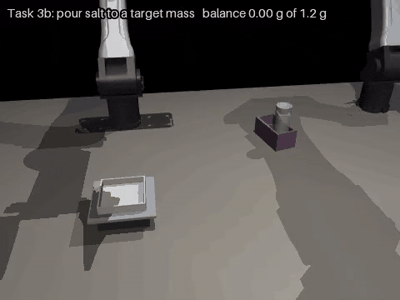
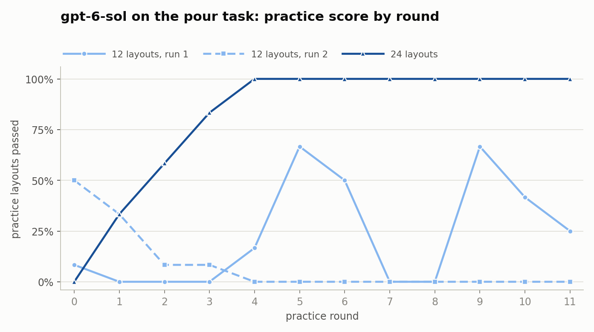

# Self-evolving robot agents on lab bench tasks: session summary

## Summary

Inspired by [Self Evolving Agentic Robotics](https://sear.bot) paper, an LLM writes the code that controls two simulated YAM robot arms
(code-as-policy). It practises in rounds: each round it rewrites a skill
library, notes and a policy script, sees how they did on practice layouts, and
the best version is kept. Its final policy is then scored once on 20 held-out
layouts it never saw.

## Tasks

| Task | What the robot must do | Judge | Reference policy |
|---|---|---|---|
| `tube_rack`  | right arm moves a named vial between racks | vial seated upright in the target cell | 40/40 |
| `snap_cap`  | open the lid of a clamped tube past 90 degrees | lid angle, at rest, released | 64/64 |
| `weigh_salt`  | left arm passes a salt vial to a shared rack; right arm pours onto a balance to a target mass (0.8 to 1.6 g, tolerance 0.2 g) | the balance reading itself | 61/64 seeds, 19/20 held-out |
| `weigh_handover`  | first half of `weigh_salt`: vial into the shared rack | vial seated, released, no salt spilled | 20/20 |
| `weigh_pour`  | second half: vial starts in the shared rack | the balance reading | 18 to 19/20 |

## Workflow

### 1. Starting a run
A round contains several runs. On each round there are several layouts. 

`RUN=sol_seq_pour MODEL=gpt-6-sol TASK=weigh_pour ROUNDS=12 EXTRA="--practice-seeds 100-123 --video" sbatch --qos=standby -N 1 -n 12 --mem=10G --time=00:40:00 cluster/run_evolve.sh`

### 2. Each round
For each round:

1. **Build prompt**: contains task description, API documentation, current best library

2. **Call the model once**: it returns a skills module, a lessons file and a policy script

3. **Parse reply**: if no policy script is found, the round score is zero and is discarded

4. **Run the code each layout**: each layout is a different random arrangement of the bench, the same set every round. We tested with 12 or 24 layouts per round

5. **Keep or discard**: if the round passes as many layouts as the previous library it becomes the new library, if not the library does not change.

Everything is saved on `round_NNN`

### 3. Held-out test
After the last round, the best library is tested against 20 layouts it has not seen. Score is in `test.json` and `summary.txt`

## Results on the weighing task

One dot per run; the number on the right is the total over the runs in that
row. "Joined" rows use Haiku's hand-over library (20/20) followed by the named
model's pour library.

| Setup | Model | Held-out per run (of 20) |
|---|---|---|
| One piece, no feedback | gpt-6-luna | 0 |
| One piece, library loop, empty start | gpt-6-luna | 0, 2 |
| One piece, starts from vial-moving skills | gpt-6-luna | 8, 0, 4, 0 |
| Same, plus grip hints | gpt-6-luna | 1, 0, 3, 1 |
| Same, plus grip hints | Claude Haiku 5.5 | 7, 0, 9, 3 |
| Two halves, pour on 12 layouts | qwen3.8-27b (low, medium effort) | 0, 0 |
| Two halves, pour on 12 layouts | Claude Haiku 5.5 | 1, 0, 4 |
| Two halves, pour on 12 layouts | gpt-6-luna | 6 |
| Two halves, pour on 12 layouts | gpt-6-sol | 13, 15 |
| Two halves, pour on 24 layouts | gpt-6-sol | 15 |

Pour-only held-out (of 20): reference 18 to 19; `gpt-6-sol` 13, 10 and 18
(24 layouts); Haiku 7, 4, 0, 1; luna 5; Qwen 0, 0.

The second 24-layout run stopped after round 4 when the provider account ran
out of credit; it was climbing like the first.

## Results on the two easier tasks

**Moving a vial** was too easy to show anything: `gpt-6-luna` passed 20/20
held-out after one model call, and fresh attempts without feedback did the same.

**Opening a snap cap** (held-out, of 20):

| Setup | Library loop | Fresh attempts, no feedback |
|---|---|---|
| 4 practice layouts | 10 | 14 |
| 12 practice layouts | 16 | 9 |
| 12 layouts, reworded lessons prompt, early stop | 13 | 16 |
| 12 layouts, no early stop, three repeats | 20, 20, 18 | 13, 16, 15 |

The early-stopping run froze a policy at its first perfect practice round,
which then failed on held-out layouts; letting practice continue fixed that.

## Key findings

- **Pouring is the hard part of the weighing task.** The hand-over was solved
  perfectly in a few rounds; every weaker model failed on dosing, on the vial
  slipping down the fingers, or on leaving the vial on the pan.
- **The loop's main contribution is keeping the best attempt.** Weaker models
  often got worse from one round to the next. Reliable selection needs enough
  practice layouts.
- **Learning in halves isolates the difficulty but cannot beat the harder
  half.** Joined scores tracked the pour score. The model did not use fixed
  modules when given the choice; it rewrote everything.
- **Hints about the grip made no measurable difference** for `gpt-6-luna`
  (4/60 with and 4/60 without over three repeats each).
- **Models need different call settings.** Haiku needed a larger output
  allowance; Qwen answered only with a reasoning-effort setting; `gpt-6-sol`
  worked with defaults.

## Cost and cluster use

- **Model spend:** a `gpt-6-sol` pour run cost $0.71 with 12 layouts and $1.36
  with 24 (feedback dominates the input). Qwen runs cost $0.15 and $0.42, luna
  runs about $0.06.
- **Cluster use** Peaks from 0.4 to 6.8 GB.

## Open issues and next steps

- **Repeat the 24-layout `gpt-6-sol` run.** It stopped after round 4 for lack
  of credit; resubmitting resumes at round 5.
- **The joined score (15) trails pour-only (18).** Unverified guess: carrying
  the vial disturbs the salt the pour policy was tuned on.
- **Held-out tests and compositions are not filmed;** only practice rounds are.
- **Negative balance readings** in some failed layouts are still unexplained.
- **Toward a deployable robot:** use these scripts to collect camera
  demonstrations and fine-tune a vision-language-action model, starting with
  the hand-over, which already succeeds every time.

## File Structure

- Code: `/biomedical-tasks` (`biolab/`, `cluster/run_evolve.sh`, `tests/`, `README.md`)
- Runs, with per-round prompts, replies, results and videos: `/biolab_runs/<run name>`
- This report and its charts: `reports/` in the code folder
- Job logs: `evolve_<job id>.log` in the code folder

