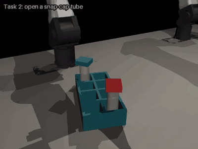
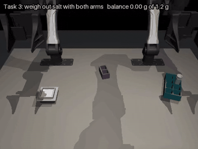
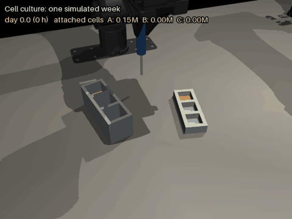
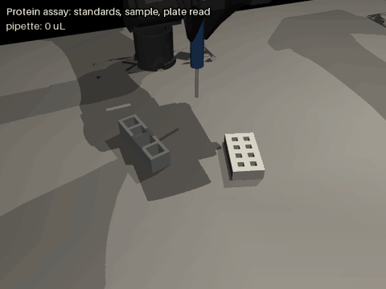
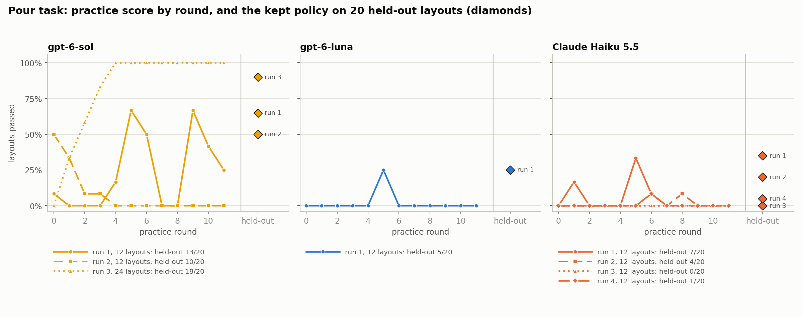
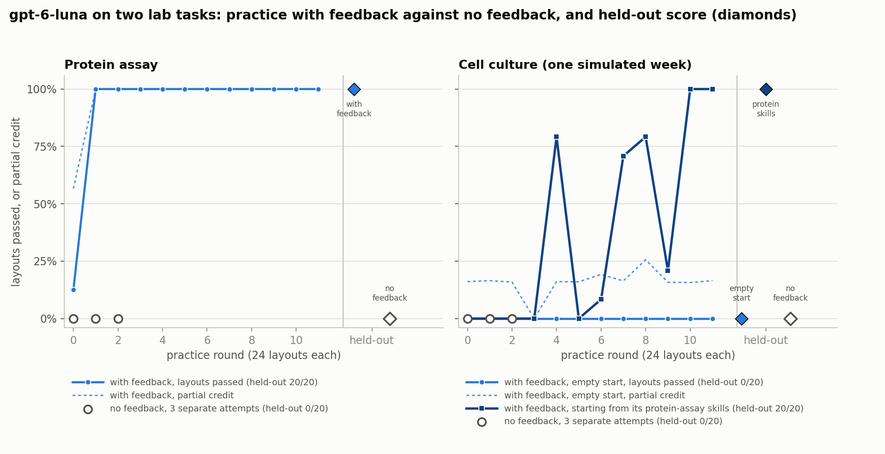
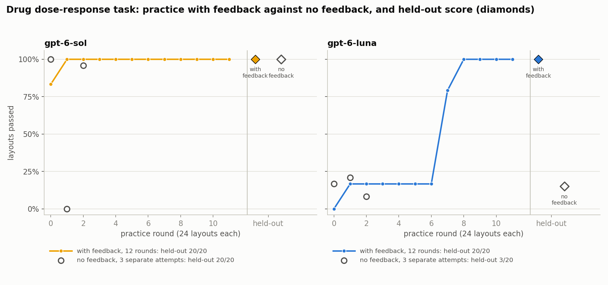

# Self-evolving robot agents on lab bench tasks: Does the skill library improve performance?

## Introduction 

Inspired by [Self Evolving Agentic Robotics](https://sear.bot) paper, an LLM writes the code that controls two simulated YAM robot arms
(code-as-policy). It practises in rounds: each round it rewrites a skill
library, notes and a policy script, sees how they did on practice layouts, and
the best version is kept. Its final policy is then scored once on 20 held-out
layouts it never saw.

## Tasks

| Task | What the robot must do | Judge | Reference policy |
|---|---|---|---|
| `tube_rack`  | right arm moves a named vial between racks | Vial seated upright in the target cell | 40/40 |
| `snap_cap`  | pen the lid of a clamped tube past 90 degrees | Lid angle, at rest, released | 64/64 |
| `weigh_salt`  | left arm passes a salt vial to a shared rack; right arm pours onto a balance to a target mass (0.8 to 1.6 g, tolerance 0.2 g) | The balance reading itself | 61/64 seeds, 19/20 held-out |
| `weigh_handover`  | first half of `weigh_salt`: vial into the shared rack | Vial seated, released, no salt spilled | 20/20 |
| `weigh_pour`  | second half: vial starts in the shared rack | The balance reading | 18 to 19/20 |
| `cell_cultue`  | feeding cells, splitting dish A into B and C, and growth to 2.4 million cells against a target of 1.8 million. Another clock simulates time and cell growth | The three dishes have at least 1.8 million attached cells At least 90% of the cells are alive No dish spent more than 6 hours less than 15% of nutrients No dish spent more than 12 hours above 95% Every dish holds at least 1 mL at the end| 18/20 |
| `protein_assay`  | find protein concentration in an unknown liquid by making a set of reference liquids with known amounts, measuring their colour with an instrument, and reading the unknown off that colour scale.| Value of 6 references by 10%   Sample contains 100 µL   Concentration reported within 10% of correct value| 20/20 |
| `drug_response` | 1. Seed cancer cells into a plate. Add a dilution series of a drug, using the protein assay’s pipetting. 2. Incubate for two days, using the culture’s growth model, with the drug slowing growth or killing cells depending on dose. 3. Read viability on the plate reader and report the dose that halves growth (the IC50).| The robot passes if its estimate of the drug concentration that halves cell growth is within 50% of the true value   Concentration reported within 10% of correct value| 20/20 |

## Workflow

### 1. Starting a run
A round contains several runs. On each round there are several layouts. 

`RUN=sol_seq_pour MODEL=gpt-6-sol TASK=weigh_pour ROUNDS=12 EXTRA="--practice-seeds 100-123 --video" sbatch --qos=standby -N 1 -n 12 --mem=10G --time=00:40:00 cluster/run_evolve.sh`

### 2. Each round
For each round:

1. **Build prompt**: contains task description, API documentation and current best library. Input to the LLM model

2. **Call the model once**: it returns a skills module, a lessons file and a policy script

3. **Parse reply**: if no policy script is found, the round score is zero and is discarded

4. **Run the code each layout**: each layout is a different random arrangement of the bench, the same set every round. We tested with 12 or 24 layouts per round

5. **Keep or discard**: if the round passes as many layouts as the previous library it becomes the new library, if not the library does not change.

Everything is saved on `round_NNN`

### 3. Held-out test
After the last round, the best library is tested against 20 layouts it has not seen. Score is in `test.json` and `summary.txt`

## Results on the weighing task

Score achieved on each round, the diamonds show the score achieved once the held-out test on the 12 rounds finished. Score increased when switching to a better LLM model (from Haiku and Luna to Sol) and when number of layouts increased (12 to 24).

## Results on the two easier tasks

**Moving a vial** was too easy to show anything: `gpt-6-luna` passed 20/20
held-out after one model call, and fresh attempts without feedback did the same.

**Opening a snap cap** left columns show the held-out score with the library loop and with no feedback

| Setup | Library loop | Fresh attempts, no feedback |
|---|---|---|
| 4 practice layouts | 10/20 | 14/20 |
| 12 practice layouts | 16/20 | 9/20 |
| 12 layouts, reworded lessons prompt, early stop | 13/20 | 16/20 |
| 12 layouts, no early stop, three repeats | 20/20, 20/20, 18/20 | 13/20, 16/20, 15/20 |

## Results on the cell, protein and drug task

For the protein assay gpt-6-luna could wrote a correct script and achieved maximum score quickly.
For the cell culture tasks, which involves handling pipetes, the score improved if the model could use the protein assay library. This suggests that previous library skills can be used as the starting point for more difficult tasks. 
**Regarding the score drops from round 4 to 5 and 8 to 9:** On round 4 the model ran out of time several layouts, so on round 5 it avoided splitting dishes and failed to reach the required amoun of cells. For round 8, some cells dishes starved while having maximum liquid volume. The important metric is nutrient concentration, not volume. On round 9 model replaced completely the liquid when there was no more nutrient, which takes longer, so the robot ran out of time. On round 10 it found the balance.

  With 24 layouts per round gpt-6-luna reach the same score as gpt-6-sol. Luna being signicantly cheaper than sol. 

## Key findings
- **Skill library improves with more layouts per round**
- **Previous Library skills can be reused** on the cell culture, score increased if the library skill for protein assay was given

- **Pouring is the hard part of the weighing task.** The hand-over was solved
  perfectly in a few rounds; every weaker model failed on dosing, on the vial
  slipping down the fingers, or on leaving the vial on the pan.

- **The loop's main contribution is keeping the best attempt.** Weaker models
  often got worse from one round to the next. Reliable selection needs more
  practice layouts.
- **Learning in halves isolates the difficulty but cannot beat the harder
  half.** Joined scores tracked the pour score. The model did not use fixed
  modules when given the choice; it rewrote everything.
- **Models need different call settings.** Haiku needed a larger output
  allowance; Qwen answered only with a reasoning-effort setting; `gpt-6-sol`
  worked with defaults.

## Open issues and next steps

- **Repeat with 24-layouts or more** runnings with 12 layouts do not improve the skill library 
- **Remove ideal robot information:** model gets robot position, not image. 
- **Held-out tests and compositions are not filmed;** only practice rounds are.
- **Negative balance readings** in some failed layouts are still unexplained.
- **Toward a deployable robot:** use these scripts to collect camera
  demonstrations and fine-tune a vision-language-action model, starting with
  the hand-over, which already succeeds every time.

## File Structure

- Code: `/biomedical-tasks` (`biolab/`, `cluster/run_evolve.sh`, `tests/`, `README.md`)
- Runs, with per-round prompts, replies, results and videos: `/biolab_runs/<run name>`
- This report and its charts: `reports/` in the code folder
- Job logs: `evolve_<job id>.log` in the code folder
